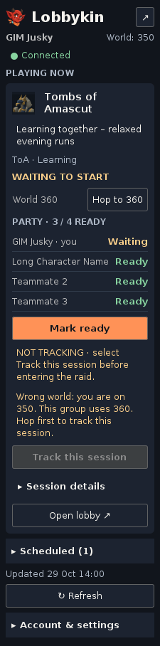

# Lobbykin

Find your people. Play together.

A RuneLite sidebar for coordinating OSRS groups on [Lobbykin](https://lobbykin.com/).
**0.9.4-rc1 is a source candidate for Plugin Hub submission**, based on 0.9.3.
It is not yet published in RuneLite Plugin Hub.



## Features

- One focused Playing now group, roster and Ready / Waiting states.
- Collapsible scheduled groups, applications and account controls.
- Browser approval with separate optional permissions.
- Explicit Hop to world using standard RuneLite world-switching APIs.
- Session reminders and optional account notifications.
- Experimental CoX, ToB and ToA start, local death, exit and completion reports.

Raid reports belong to an explicitly selected session. Death does not complete a
raid; exiting or losing connection is not success. Combining different players'
reports happens on the Lobbykin service, outside this repository. Live
multiplayer validation remains required before submission.

## Installation after approval

Once accepted, open RuneLite's Plugin Hub, search Lobbykin, install and enable it.
This installation route will not require a BAT launcher or local development JDK.
Until acceptance, this is a development candidate with no Plugin Hub listing.

## Connect and use

1. Open the sidebar and choose **Connect with Lobbykin**.
2. Sign into Lobbykin in your browser, review and approve your chosen permissions.
3. Join or host a session on the website. Your own groups appear in the plugin.
4. Use **Mark ready** and **Hop to** explicitly as needed.
5. For raid reports, grant that permission and select **Track this session before
   entering the raid**, on the group's world.
6. Stop tracking or disconnect when done. Revoke server access from the
   [RuneLite access page](https://lobbykin.com/runelite.html).

Access is memory-only: reconnect after restarting the client. Characters and
HiScores are not official ownership verification. Connection, world or character
changes may interrupt tracking. Combat input is not automated.

## Data and permissions

Read [PRIVACY.md](PRIVACY.md) for fields/destinations and [SECURITY.md](SECURITY.md)
for security boundaries. No game chat text or Jagex password is sent. There are
no paid features or donation prompts in this candidate.

## Development

Use JDK 17 with the bundled Gradle 8.10 wrapper. Plugin bytecode targets Java 11.
The default RuneLite version is 1.13.4, matching official Plugin Hub
`runelite.version` checked on 2026-10-30. Check that version again before submission.

```sh
./gradlew --no-daemon clean test jar
./gradlew run
```

Windows: use `gradlew.bat`; `START_LOBBYKIN.bat` is a development helper only.
Override the dependency with `-PruneLiteVersion=latest.release` when testing updates.
Plugin Hub replaces this local build under `build=standard`. There are no added
main-runtime dependencies beyond RuneLite's transitive dependencies. Tests use
JUnit and the RuneLite development client. The JAR is not a standalone program.

See [SUBMISSION_LT.md](SUBMISSION_LT.md) for release gates and submission steps,
and [VALIDATION.md](VALIDATION.md) for the actual checks completed here.

## Support and license

After creating the public repository, use its GitHub Issues for bug reports.
Include version, raid/mode, steps and expected/actual behavior; omit credentials.
Project code uses BSD-2-Clause ([LICENSE](LICENSE)); wrapper licensing and asset
provenance are in [NOTICE.md](NOTICE.md). Not affiliated with or approved by
Jagex or RuneLite. RuneLite reviewers decide acceptance.
